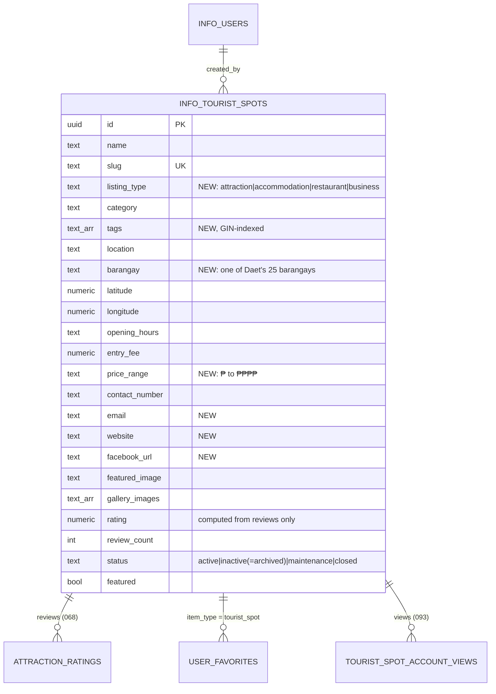

# Places directory and events (Phase 2)

The public site lists four kinds of places, all managed by the Tourism Officer
(or Admin) from **Admin → Places Directory** (`/info/admin/tourist-spots`):

| Listing type | `listing_type` | Public tab | Example categories |
| --- | --- | --- | --- |
| Attraction | `attraction` | See & Do | beach, historical, nature, park |
| Accommodation | `accommodation` | Stay | hotel, resort, inn, homestay |
| Restaurant | `restaurant` | Eat & Drink | filipino, seafood, cafe |
| Local business | `business` | Shops & Services | pasalubong, surf school, tour operator |

All four live in `info_tourist_spots`. A single table was chosen on purpose:
reviews and ratings (068), favourites, view analytics (085/092/093), comments
and reactions are already keyed to the spot id, so every listing type gets
them with no extra tables or joins.

Events and festivals already had full CRUD, schedules (start/end date and
time), venue, map pin, publish/unpublish and an approval queue
(`/info/admin/events`, `/info/admin/event-approvals`). Phase 2 only opens them
to the Tourism Officer role.

## Data model changes (migration 097)



### Access rules

| Who | Listings (`info_tourist_spots`) | Events (`info_events`) |
| --- | --- | --- |
| Visitor / User | Read `active` rows | Read published + approved; users submit their own for approval (unchanged) |
| Tourism Officer, Admin | Full CRUD, archive, feature | Full CRUD, publish/unpublish, approve |
| Moderator | No access | No access |

Fixed in 097: any signed-in user could previously insert a listing with
themselves as `created_by`, and it went public immediately. Listing writes
are now staff-only, and the admin page makes every write through the API
(which validates input and writes the audit log).

## What changed

**Admin (Places Directory)**
- Type tabs with counts; "Add Listing" pre-selects the open tab's type.
- New fields: listing type, tags, barangay, price range, email, website,
  Facebook page. Category is free text with suggestions per type.
- The manual **rating** field was removed. It overwrote the rating
  calculated from reviews on every save.
- Archive / restore / feature and bulk actions go through
  `PATCH /info/api/admin/tourist-spots[/id]`; bulk delete through `DELETE`.
  Every create, update, archive and delete is written to `info_audit_log`.
- Server-side validation (`src/lib/listings.mjs`): coordinates in range and
  both-or-neither, non-negative fee, valid email, http(s)-only links, at most
  15 tags and 20 gallery images.

**Public directory** (`/info/visitor/tourist-spots`)
- Tabs: All · See & Do · Stay · Eat & Drink · Shops & Services, shareable as
  `?type=restaurant`.
- Filters: barangay, minimum rating, category; sort by recommended, rating,
  most reviewed, or name. Search also covers tags and barangay.
- Star rating with review count ("New" when unreviewed). It used to be a
  heart icon, easy to confuse with the save button.
- Guests who tap **save** are sent to sign in and come back to the same page.
- Signed-in users can now open the directory list. Before, the proxy
  redirected them to their dashboard; only the detail page was allowed.

**Detail page**
- Listing type badge, price range, barangay, tags.
- Contact card: tap-to-call, email, website, Facebook, and a **Get
  directions** button.
- Entrance fee now displays. It read `entrance_fee`, but the column is
  `entry_fee`, so the fee never showed.
- "You might also like" stays within the same listing type.

## Caching decision

| Item | Decision |
| --- | --- |
| Data | Active public listings (`status = 'active'`) |
| Cache key | `getCacheKey('places', 'public', 'all', LISTINGS_CACHE_VERSION)`; version `daet-directory-v2` in `src/lib/listings.mjs` |
| TTL | 24 h in the browser's persistent cache; shown instantly, then revalidated from Supabase on every visit |
| Invalidation | Admin page clears the key after each successful create, update, archive, feature or delete; realtime subscription on `info_tourist_spots` refreshes open tabs |
| Stale / offline | Cached list renders if the network fails; never shows archived listings, because only active rows are ever cached |
| Classification | Public. No user data in the cached payload (favourites are fetched separately and not cached) |
| Manual clear | Bump `LISTINGS_CACHE_VERSION`, or clear site data in the browser |
| Admin data | `private, no-store`; never cached |

## How to test

```bash
npx supabase db push          # applies 096 (if not yet) and 097
npm test
npm run dev
```

1. Sign in as `tourism.officer@connectdaet.test` → **Places Directory**.
   - Six sample listings appear under Accommodations, Restaurants, and Local
     Businesses (each description starts with "Sample listing").
   - Add a restaurant with tags, barangay, price range, and website; save.
   - Try an invalid website (`javascript:alert(1)`) or a latitude of 200;
     you should see a clear error.
   - Archive it, then restore it; select two listings and **Feature** them.
2. Open `/info/visitor/tourist-spots` in a private window (guest).
   - Switch tabs; `?type=` changes in the URL.
   - Filter by **Bagasbas** and by rating; search a tag such as `surf`.
   - Tap the heart: you're sent to sign in, then returned to the directory.
   - Open a listing: contact card, tap-to-call, Get directions, and fee.
3. Sign in as `moderator@connectdaet.test`: `/info/admin/tourist-spots`
   redirects to the dashboard.
4. As the tourism officer, open **Events**, edit an event created by
   someone else, and publish/unpublish it. Before 097 the database refused this.
5. Self-check (should fail): signed in as the tourist, in the browser console:
   `supabase.from('info_tourist_spots').insert({ name: 'x', category: 'beach' })`.
