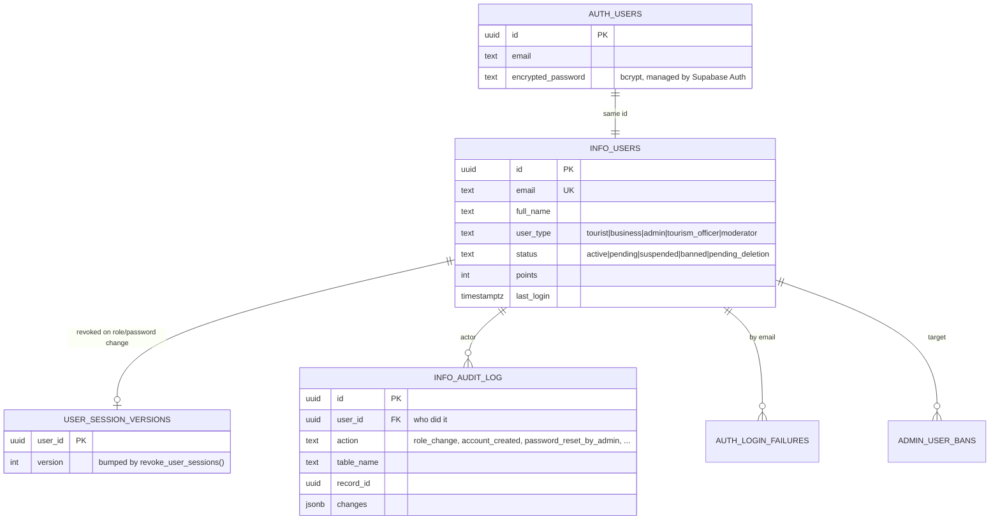

# Roles and access control (Phase 1)

Connect Daet has one public site (Visitors and registered Users) and one admin
console at `/info/admin` shared by three staff roles. Access is enforced in
four places, all driven by **one rules file**:

| Layer | Where | What it checks |
| --- | --- | --- |
| Rules | [`src/lib/staffRoles.mjs`](../src/lib/staffRoles.mjs) | Roles, permissions, page rules, API rules |
| Pages | [`src/proxy.js`](../src/proxy.js) | Non-staff → `/info/access-denied`; staff without the page permission → dashboard |
| APIs | [`src/lib/adminApiAuth.js`](../src/lib/adminApiAuth.js) | Every `/info/api/admin/*` handler; path + HTTP method → permission; 401/403 |
| Menus | [`AdminSidebar.js`](../src/app/(subsystems)/info/components/AdminSidebar.js) | Shows only links the proxy would allow |
| Database | [`096_staff_roles_rbac.sql`](../supabase/migrations/096_staff_roles_rbac.sql) | Reviewer checks in moderation RPCs; blocks self-promotion |

Anything under `/info/admin` or `/info/api/admin` with no rule is **admin-only**
(deny by default). To open a new page to a role, add a line to `PAGE_RULES` /
`API_RULES`; the sidebar follows automatically.

### Per-person permissions (migration 102)

An administrator can tick extra permissions for one Tourism Officer or
Moderator, or untick ones their role normally has (Users -> Edit). Overrides
are stored in `staff_permission_overrides`, loaded at sign-in into the signed
session (`perms`), and honoured by the proxy, every admin API and the sidebar
(`GET /info/api/admin/me`). `users.manage` and `system.manage` can never be
granted this way, and `console.access` / `account.self` can never be removed.
Saving overrides signs the user out so they apply at the next sign-in; changing
the role clears them.

## Roles

`info_users.user_type` holds the role.

| Role | `user_type` | Signs in to |
| --- | --- | --- |
| Visitor (guest) | — (no account) | Public site, read-only |
| User (registered tourist) | `tourist` (or `business`) | Public site |
| Moderator | `moderator` | Admin console |
| Tourism Officer | `tourism_officer` | Admin console |
| Admin | `admin` | Admin console (everything) |

## Permission matrix

| Permission | Admin | Tourism Officer | Moderator | Console areas |
| --- | :-: | :-: | :-: | --- |
| `console.access` | ✓ | ✓ | ✓ | Dashboard, weather |
| `account.self` | ✓ | ✓ | ✓ | My Account (profile, password, 2FA, sessions) |
| `media.use` | ✓ | ✓ | ✓ | Upload to shared media library (delete: admin) |
| `content.notify` | ✓ | ✓ | ✓ | Notify followers when content is published |
| `tourism.manage` | ✓ | ✓ | | Tourist spots, events, event approvals |
| `alerts.broadcast` | ✓ | ✓ | | Alerts, Notifications → Send |
| `announcements.manage` | ✓ | | ✓ | Official announcements |
| `feedback.manage` | ✓ | ✓ | | Feedback / inquiries |
| `analytics.view` | ✓ | ✓ | | Analytics, engagement |
| `moderation.manage` | ✓ | | ✓ | Reported content, blog moderation, community guidelines |
| `forum.manage` | ✓ | | ✓ | Forum topics and categories |
| `users.view` | ✓ | | ✓ | Users list (read) |
| `users.manage` | ✓ | | | Create accounts, change roles, reset passwords, delete |
| `system.manage` | ✓ | | | Settings, data/backups, activity logs, messaging, system health |

## Data model (Phase 1 scope)

Existing tables relevant to auth and roles, plus what migration 096 adds.
Tables for later phases (alerts, listings, reviews, …) are added in those phases.



### Database functions added by 096

- `is_staff_in(user_id, roles[])`: true when the user is **active** and holds
  one of `roles` (admin always passes).
- `admin_set_user_role(admin_id, target_id, role)`: the only path that changes
  a role. Re-checks that the caller is an admin, refuses self-change, keeps at
  least one active admin, writes `info_audit_log` and revokes the target's
  sessions.
- Trigger `guard_info_users_privileged_columns`: browser (anon/authenticated)
  requests can no longer change `user_type`, and only an admin can change
  `status` or `points`. Service-role API routes are unaffected.
- Reviewer checks widened in place: blog moderation RPCs accept `moderator`;
  `moderate_info_event` accepts `tourism_officer`.

## Security notes

Community submissions follow pre-moderation: user blogs, forum topics and replies,
community posts, and comments are held as pending until a moderator approves
them. Moderators and administrators can still publish official announcements.

Users can report content, comments, reposts, visitor reviews, and accounts.
Approving an account report resolves the report and applies an account suspension
in one database transaction. Moderators classify severity as minor (7 days),
moderate (30 days), severe (90 days), or critical (permanent); staff accounts
cannot be suspended through community reports.

- Passwords are stored only by Supabase Auth (bcrypt). Admin-created accounts
  and admin password resets go through `POST`/`PATCH /info/api/admin/users`;
  nothing writes a password to `info_users` any more.
- The role used for authorization comes from the signed, HTTP-only
  `daet_secure_session` cookie, created at login from `info_users.user_type`.
  `user_metadata` (user-editable) can no longer grant a staff role.
- Role changes take effect on the next sign-in; `admin_set_user_role` forces
  that by bumping the session version, which the proxy checks on every request.

## Caching decision

| Item | Decision |
| --- | --- |
| Data | Caller's role and permissions |
| Cache key | Signed session cookie (`daet_secure_session`), per user |
| TTL | Session lifetime (24 h, 30 d with "remember me") |
| Invalidation | `revoke_user_sessions()` on role change / password reset; proxy compares session version on each request |
| Stale/offline | Session version lookup failure → 503 for APIs, retry page for pages (never fail open) |
| Classification | Sensitive (authorization) — HTTP-only, signed, never in shared/public caches |
| Manual clear | Sign out, or an admin changes the role / resets the password |

## Testing

```bash
# 1. Apply the migration (local stack, or `supabase db push` for your dev project)
npx supabase db reset            # local; or: npx supabase db push

# 2. Create one account per role (prints the generated passwords)
node scripts/seed_staff_accounts.js

# 3. Unit tests (policy, sidebar consistency, migration guards)
npm test

# 4. Manual check
npm run dev
```

Sign in as each seeded account and confirm:

| Account | Should see | Should be redirected away from |
| --- | --- | --- |
| `tourism.officer@connectdaet.test` | Tourist Spots, Events, Announcements, Notifications, Feedback, Analytics | `/info/admin/moderation`, `/info/admin/users`, `/info/admin/settings` |
| `moderator@connectdaet.test` | Blog, Forum, Users, Reported Content | `/info/admin/tourist-spots`, `/info/admin/notifications/send`, `/info/admin/settings` |
| `admin@connectdaet.test` | Everything; can change roles on Users | — |
| `tourist@connectdaet.test` | Public user dashboard | any `/info/admin/*` → access denied |

Self-promotion check (should fail with "Roles can only be changed by an
administrator"): signed in as the tourist, in the browser console run
`supabase.from('info_users').update({ user_type: 'admin' }).eq('id', '<own id>')`.
